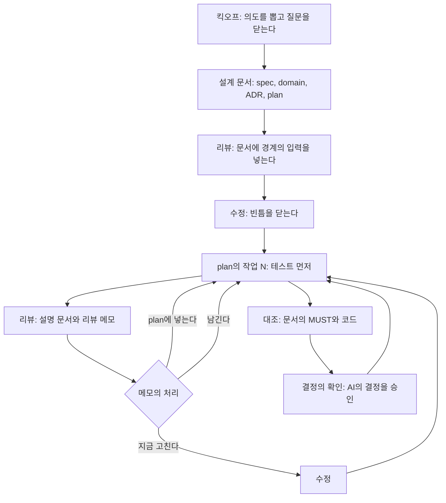

# tstack 가이드

- tstack은 이 프로젝트(trealworld)의 일지 57스텝과 커밋 24개에서 뽑은 개발 워크플로의 스킬 세트다.
- 구조는 Lauren Tan의 pstack의 원리를 따른다. 근거는 [`like-pstack.md`](like-pstack.md)다.
- 플러그인의 위치: [`tstack/`](tstack/). 기준: 2026-11-17.

---

## 0. 30초 요약

tstack은 **라우터 1개 + playbook 10개 + principle 12개 + 검사 스크립트 1개 + 회고 스킬 1개 + 리뷰어 agent 1개**다.

당신이 하는 일은 셋이다.

1. **목표를 말한다.** 절차는 말하지 않는다. 예: "plan의 작업 3을 한다."
2. **보고를 읽는다.** 검증의 표와 "열린 것"을 본다.
3. **다음 스텝을 고른다.** AI는 스텝 하나가 끝나면 멈춘다.

AI가 하는 일은 여섯이다.

1. 목표를 자기 말로 다시 말한다.
2. 요청에 맞는 playbook을 고른다.
3. playbook의 단계를 todo에 그대로 옮긴다.
4. 단계를 실행한다. 원칙은 적용할 때 읽는다.
5. 실제의 산출물로 검증한다. 일지를 쓴다.
6. 증거를 붙여서 보고하고 멈춘다.

---

## 1. 설치

| 방법 | 명령 | 언제 쓰는가 |
|---|---|---|
| 한 번 써 보기 | `claude --plugin-dir ./tstack` | 이 저장소의 폴더에서 바로 시작한다. 설치하지 않는다. |
| 설치 | `/plugin install tstack --marketplace tobyilee/trealworld` | 다른 프로젝트에서도 쓴다. 저장소에 push한 뒤에 된다. |

- 매니페스트 2개는 `claude plugin validate`를 통과했다 (확인).
- 실제 세션에 플러그인을 올려서 스킬이 뜨는 것은 아직 보지 않았다 (미확정). 처음 쓸 때 `/tstack:t-mode`가 목록에 있는지 본다.
- 검사 스크립트는 Python 3만 있으면 돈다. 다른 패키지는 필요하지 않다.

스킬의 이름:

| 이름 | 부르는 방법 | 역할 |
|---|---|---|
| `t-mode` | `/tstack:t-mode <목표>`. 요청이 맞으면 저절로 불린다. | 입구. 모든 작업은 여기로 온다. |
| `t-reflect` | `/tstack:t-reflect`. 직접 불러야 한다. | 일지에서 반복된 교정을 찾아 tstack을 고친다. |
| `t-reviewer` | 부르지 않는다. **리뷰** playbook이 부른다. | 쓴 사람이 아닌 agent의 리뷰. |

---

## 2. 한 주기

이 프로젝트에서 반복된 주기는 "쓴다 → 다시 읽는다 → 고친다"다. 문서에서도 코드에서도 같다.



- 화살표마다 당신의 요청이 있다. AI는 화살표를 스스로 넘지 않는다.
- 모든 상자의 끝에 **마무리**가 있다: 일지, 보고, 요청이 있을 때의 커밋.
- **현황**은 어느 때나 부른다. "남은 작업은?"

---

## 3. 요청하는 법

prompt에는 아래의 5가지만 넣는다. 절차와 스킬의 이름은 넣지 않는다. 넣으면 playbook의 순서를 덮어쓴다.

| # | 넣는 것 | 예 |
|---|---|---|
| 1 | 목표 | "작업 4를 한다" |
| 2 | 끝의 조건 | plan의 "검증할 내용"에 이미 있으면 뺀다 |
| 3 | 보고 싶은 증거 | "동시의 요청으로 확인해" |
| 4 | 이미 아는 것 | "8080은 다른 프로세스가 쓴다" |
| 5 | 실제의 제약 | "간결하게. plan에 코드를 넣지 않는다" |

### 말과 playbook

| 당신의 말 | playbook | 끝에 받는 것 |
|---|---|---|
| "이 API spec으로 킥오프하자", "브레인스토밍" | 킥오프 | 브레인스토밍 문서, 닫은 질문과 남은 질문 |
| "슬라이스의 spec, domain, ADR, plan을 쓴다" | 설계 문서 | 문서 4종, ID의 수, AI가 제안한 것의 목록 |
| "작업 3을 한다", "다음 작업 진행" | plan의 작업 | 검증의 표, 결함을 넣은 표, 실제의 응답 |
| "설명 문서를 만든다", "이 커밋을 리뷰" | 리뷰 | 리뷰 메모의 표, 처리를 묻는 질문 |
| "메모 1을 고친다", "빈틈을 닫는다" | 수정 | 원인, 전과 후의 표 |
| "문서를 기준으로 코드를 검증한다" | 대조 | 넷으로 나눈 표, 더한 테스트 |
| "AI의 제안을 승인한다", "확인이 필요한 것은?" | 결정의 확인 | 결정의 표, 승인의 기록 |
| "남은 작업은?" | 현황 | 네 목록 |
| `cm`, `cmp`, "커밋" | 마무리 | 커밋마다 내용 한 줄, 넣지 않은 파일 |
| 위에 없는 요청 | 직접 설계 | 설계한 단계와 판정 |

### 새 프로젝트를 시작하는 순서

| 순서 | 요청 | 한 번에 묶어도 되는가 |
|---|---|---|
| 1 | "이 자료로 킥오프한다. 코드는 쓰지 않는다." | 질문의 답은 묶어서 준다. |
| 2 | "첫 슬라이스의 설계 문서를 쓴다." | 문서 4종은 한 번에 요청한다. |
| 3 | "설계 문서를 리뷰한다." → "빈틈을 닫는다." | 따로 한다. |
| 4 | "작업 1을 한다." → `cm` → "리뷰" → `cmp` | 작업마다 반복한다. |
| 5 | 작업 2 ~ 3개마다 "결정의 확인" | 쌓이기 전에 한다. |
| 6 | 슬라이스의 끝에 "대조" | 한 번 한다. |
| 7 | 슬라이스의 끝에 `/tstack:t-reflect` | 한 번 한다. |

---

## 4. 보고를 읽는 법

모든 스텝은 같은 모양의 보고로 끝난다 ([`report-template.md`](tstack/skills/t-mode/references/report-template.md)).

| 절 | 당신이 볼 것 |
|---|---|
| **목표** | AI가 요청을 맞게 이해했는가. |
| **Playbook** | 건너뛴 단계와 이유. `skip`이 이상하면 묻는다. |
| **검증** | 판정의 열. **미확정**은 통과가 아니다. |
| **적용한 원칙** | 원칙이 바꾼 결정이 적혀 있는가. 없으면 장식이다. |
| **열린 것** | 확인이 필요한 결정의 수. 5개를 넘으면 **결정의 확인**을 한다. |
| **다음 스텝의 후보** | 한 줄이다. 따를 필요는 없다. |

판정은 셋이다.

| 판정 | 뜻 |
|---|---|
| 확인됨 | 실행해서 봤다. 증거가 붙어 있다. |
| 실패 | 실행했고 조건에 맞지 않는다. |
| 미확정 | 실행하지 못했다. 이유가 붙어 있다. |

사실의 라벨은 넷이다: **확인**(실행해서 봤다), **읽음**(읽기만 했다), **추정**(확인하지 않았다), **질문**(당신이 정할 일이다).

---

## 5. 원칙을 조종하는 말로 쓴다

원칙의 이름은 당신이 쓰는 말이기도 하다. 방향을 바꾸고 싶을 때 이름을 말한다.

| 이렇게 말한다 | AI가 하는 일 | 일지의 사례 |
|---|---|---|
| "**사용자가 속도를 정한다**. 거기서 멈춰." | 요청한 스텝만 하고 멈춘다. | 2026-11-16 스텝 6 |
| "**스텝의 범위만 한다**. 그건 작업 4의 일이야." | 요구하는 테스트가 없는 것을 만들지 않는다. | 스텝 30 |
| "**실패를 본 검사만 믿는다**. 결함을 넣어 봐." | 결함을 넣고 잡은 테스트의 표를 준다. | 스텝 25, 44, 49 |
| "**실제 표면에서 본다**. 서버에서 보여 줘." | 서버를 띄우고 응답의 표를 준다. | 스텝 35, 37 |
| "**상태가 아니라 이유를 확인한다**. 왜 401이야?" | 실패와 통과의 이유를 확인한다. | 스텝 51 ~ 52 |
| "**주장에 라벨을 붙인다**. 그건 확인이야 추정이야?" | 라벨을 붙이고, 싼 추정은 확인한다. | 스텝 37, 48 |
| "**결정의 출처를 남긴다**. 누가 정했어?" | AI의 결정을 목록으로 만든다. | 스텝 14, 54 |
| "**규칙을 쓰인 대로 지킨다**. MUST야." | 규칙을 좁히지 않고 기록을 맞춘다. | 2026-11-16 스텝 10 ~ 11 |
| "**ID로 잇는다**. 어느 AC야?" | ID를 만들고 `trace`를 돌린다. | 스텝 17 |
| "**결론은 문서에, 과정은 일지에**. plan에 넣어." | 남은 일을 plan의 검증 항목으로 옮긴다. | 스텝 28 → 30 |
| "**규칙을 검사로 옮긴다**. 테스트로 강제해." | 테스트나 스크립트를 더한다. | 스텝 44 |
| "**원인을 고친다**. 다른 곳에도 있어?" | 넓게 보고 원인의 문장을 쓴다. | 스텝 52 |

원칙의 본문은 [`tstack/skills/t-mode/principles/`](tstack/skills/t-mode/principles/)에 있다. 본문의 절은 여섯이다: 규칙, 왜, 방법, 멈춤, 쓴 흔적, 사례.

---

## 6. AI가 묻지 않는 것과 묻는 것

pstack은 "되돌릴 수 있으면 진행한다"가 기본이다. tstack은 다르다. **스텝의 안에서는 진행하고, 스텝의 사이에서는 멈춘다.**

| 구분 | 예 |
|---|---|
| 묻지 않고 한다 | 읽기, 테스트와 빌드, 서버를 다른 포트에 띄우기, 스크래치 폴더의 빌드, 결함을 임시로 넣고 되돌리기 |
| 요청이 있어야 한다 | plan의 다음 작업, 리뷰 메모의 수정, 커밋 |
| 항상 멈추고 묻는다 | push, push한 커밋의 역사의 변경, AI가 만들지 않은 파일의 커밋과 삭제, 승인된 문서의 뜻의 변경, 규칙의 변경 |
| 하고 표시한다 | 승인된 문서에 구현의 결론을 더하는 일. "확인이 필요하다"로 남긴다. |

AI는 묻기 전에 분류한다.

- 실행해서 볼 수 있는 사실은 묻지 않고 실행한다.
- 승인된 결정에서 답이 나오면 묻지 않는다 (스텝 17: 8개 중 1개만 물었다).
- 당신만 정할 수 있는 것은 묶어서 묻는다. 선택지와 권장을 준다.

당신이 AI의 권장과 다르게 고르는 것은 정상이다 (스텝 17, 22). AI는 그대로 하고, 그 결과가 다른 결정과 부딪치는 곳을 문서에 적는다.

---

## 7. 검사 스크립트

글로 쓴 규칙은 가장 약한 강제다. 그래서 네 가지를 스크립트로 옮겼다.

| 명령 | 검사하는 것 | 언제 도는가 |
|---|---|---|
| `trace` | spec과 domain의 ID가 plan에 모두 있는가. ID마다 이름에 `ac1_1_`, `r4_`가 있는 테스트가 있는가. | 설계 문서, plan의 작업, 대조, 현황 |
| `keywords` | 수준의 열과 문장의 키워드가 맞는가. 굵지 않은 "반드시". 허용이 아닌 "수 있다". | 설계 문서, 대조 |
| `journal` | 바뀐 파일이 있는데 오늘의 일지가 바뀌지 않았는가. | 마무리 |
| `self` | 라우터의 색인과 파일이 맞는가. playbook이 `**보고:**`로 끝나는가. | tstack을 고친 뒤 |

직접 돌리는 방법:

```bash
python3 tstack/skills/t-mode/scripts/tstack-check.py trace
```

```bash
python3 tstack/skills/t-mode/scripts/tstack-check.py keywords
```

끝의 코드: `0`은 통과, `1`은 실패, `2`는 미확정이다.

이 스크립트도 "실패를 본 검사"다. 이 프로젝트의 복사본에 결함 8가지를 넣었고 8가지를 모두 잡았다.

| 넣은 결함 | 잡은 검사 |
|---|---|
| spec에 AC-3.6을 더한다 (plan과 테스트에 없다) | `trace`: 2줄 |
| 테스트의 이름에서 `r9_`를 지운다 | `trace` |
| plan이 없는 ID(R11)를 가리킨다 | `trace` |
| AC-1.7의 문장에서 "절대"를 뺀다 | `keywords` |
| 가능성의 "수 있다"를 쓴다 | `keywords` |
| 굵지 않은 "반드시"를 쓴다 | `keywords` |
| playbook의 `**보고:**` 줄을 지운다 | `self` |
| 색인에 없는 principle을 넣는다 | `self` |
| (대조군) 바꾸지 않은 복사본 | 통과 |

한계 (읽음):

- `trace`는 테스트의 **이름**만 본다. 테스트가 그 요구를 실제로 검증하는지는 보지 않는다. 그것은 **대조**의 결함을 넣는 확인이 본다.
- `trace`의 이름의 규칙(`ac1_1_`, `r4_`)은 이 프로젝트의 ADR-0004의 규칙이다. 다른 규칙을 쓰는 프로젝트에서는 스크립트를 고친다.
- `keywords`는 한국어의 키워드만 본다.
- `journal`은 일지의 파일이 바뀌었는지만 본다. 내용이 그 스텝을 다루는지는 보지 않는다.

---

## 8. tstack을 키우는 법

작업의 중간에 스킬을 고치지 않는다. 슬라이스의 끝에 `/tstack:t-reflect`를 부른다.

| 규칙 | 뜻 |
|---|---|
| 두 번의 규칙 | 서로 다른 스텝에서 두 번 나온 교정만 올린다. 한 번 나온 것은 미룬다. |
| 강제의 사다리 | 구조 → 스크립트와 아키텍처 테스트 → 테스트 → 글. 위에서부터 고른다. |
| 승인의 전에는 고치지 않는다 | 수정안을 "받아들인다, 버린다, 미룬다"로 보여 주고 기다린다. |
| 다른 커밋 | 스킬의 변경은 프로젝트의 변경과 나눈다. |
| 프로젝트의 것은 프로젝트에 | 기술과 패키지의 이름은 tstack이 아니고 그 프로젝트의 ADR에 넣는다. |

손으로 고칠 때의 규칙:

- 라우터에는 색인 한 줄만 더한다. 본문은 파일로 만든다.
- playbook은 25줄 이하다. 첫 단계가 기준을 잡는다. 마지막 줄이 `**보고:**`다.
- 고친 뒤에 `tstack-check.py self`를 돌린다.

---

## 9. 어디에서 왔는가

### 9.1 반복된 작업의 유형 → playbook

| 유형 | 일지의 스텝 | 횟수 | playbook |
|---|---|---|---|
| 의도를 뽑고 질문을 닫는다 | 1, 4 ~ 7 | 5 | 킥오프 |
| 설계 문서를 쓰거나 다시 쓴다 | 13, 42, 43 | 3 | 설계 문서 |
| plan의 작업을 구현한다 | 19, 25, 30, 35, 40, 49 | 6 | plan의 작업 |
| 커밋을 설명 문서로 리뷰한다 | 10, 16, 21, 27, 32, 37, 46, 48, 51, 53 | 10 | 리뷰 |
| 리뷰 메모나 결함을 고친다 | 11, 17, 28, 38, 45, 52 | 6 | 수정 |
| 문서를 기준으로 코드를 대조한다 | 44 (plan의 작업 7도 같은 일이다) | 1 + 예정 1 | 대조 |
| AI의 결정을 승인한다 | 14, 54 | 2 | 결정의 확인 |
| 남은 일을 묻는다 | 48, 54 | 2 | 현황 |
| 커밋하고 push한다 | 8, 9, 12, 15, 18, 20, 22, 24, 26, 29, 31, 34, 36, 39, 41, 47, 50, 55, 57 | 19 | 마무리 |
| 한 번만 나온 것 (학습용 게임) | 56 | 1 | 없다. 직접 설계로 간다. |

두 번의 규칙에 따라 게임은 playbook으로 만들지 않았다. 게임에서 쓴 방법 하나("판정의 함수를 실제 서버와 대조한다")는 설명 문서의 위젯에서도 썼다. 그래서 **직접 설계**의 6번 단계가 됐다.

### 9.2 반복된 교정과 확인된 방법 → principle과 단계

| 교정 | 일지의 스텝 | 무엇이 됐는가 |
|---|---|---|
| AI가 앞서간다 | 11-16의 6, 11 | 사용자가 속도를 정한다. 마무리의 8번 |
| AI가 MUST를 자기 판단으로 좁힌다 | 11-16의 10, 11. 11-17의 40 | 규칙을 쓰인 대로 지킨다. `journal` 검사 |
| 처음부터 초록인 테스트 | 25, 30, 44, 49 | 실패를 본 검사만 믿는다. plan의 작업의 5번 |
| 테스트가 통과한 뒤에 서버에서 찾은 것 | 35, 37, 49 | 실제 표면에서 본다. plan의 작업의 6번 |
| 틀린 이유의 401이 통과했다 | 30, 49, 51, 52 | 상태가 아니라 이유를 확인한다 |
| 추정이 틀렸다 | 35 → 37, 40 → 48 | 주장에 라벨을 붙인다. 리뷰 메모의 "종류"의 열 |
| AI의 결정이 확인 없이 쌓였다 | 13, 14, 27, 37, 40, 49, 54 | 결정의 출처를 남긴다. 결정의 확인. 보고의 "열린 것" |
| "남은 일"이 일지에만 있었다 | 28, 30 | 결론은 문서에, 과정은 일지에 |
| 사람이 지킨 규칙이 23곳에서 빠졌다 | 25, 44 | 규칙을 검사로 옮긴다. `trace` 검사 |
| 증상이 아니고 원인 | 37 → 38, 45, 52 | 원인을 고친다. 수정의 2번과 5번 |
| 요구하지 않은 것을 미리 만들지 않는다 | 19, 25, 30 | 스텝의 범위만 한다 |
| ID가 고칠 곳을 알려 줬다 (교정이 아니고 확인된 방법이다) | 13, 17, 44 | ID로 잇는다. `trace` 검사 |
| `git add -A`가 다른 파일을 넣었다 | 32, 36 | 마무리의 1번과 6번. 라우터의 "항상" |
| 쓴 사람이 자기의 결정을 다시 보면 모두 "유지"다 | 54 | `t-reviewer` agent. 리뷰의 4번 |

마지막 줄은 한 번만 나왔다. 그래도 넣었다. `like-pstack.md`의 검증 모델("작성자는 판정자가 아니다")이 같은 것을 말한다. 근거가 일지와 pstack의 두 곳이다.

### 9.3 pstack에서 가져온 것 8가지

| # | pstack의 생각 | tstack에서 |
|---|---|---|
| 1 | 입구 하나 | `t-mode`. 사람은 목표만 말한다. |
| 2 | 색인과 본문의 분리 | 라우터는 85줄이다. 본문은 파일 28개에 있다. `self`가 검사한다. |
| 3 | todo에 그대로 복사 | 건너뛴 단계는 `skip: <이유>`로 남는다. |
| 4 | 조건 → 행동 | 라우터의 "항상"과 원칙의 색인의 "언제". |
| 5 | 검증을 구조에 넣기 | 모든 playbook의 1번 단계가 기준을 잡는다. |
| 6 | 보고 계약 | `report-template.md`와 playbook마다의 `**보고:**` 줄. |
| 7 | 자율성 계약 | 스텝의 안과 사이를 나눴다. pstack과 다르다. |
| 8 | 교정을 구조로 | `t-reflect`와 `tstack-check.py`. |

### 9.4 pstack과 다르게 한 것

| 다른 점 | 이유 |
|---|---|
| 스텝의 사이에서 멈춘다 | 이 프로젝트의 규칙이다. 속도의 기준이 사람의 이해다 (스텝 23). |
| principle이 독립 스킬이 아니고 파일이다 | 스킬의 목록이 원칙으로 채워지지 않는다 (`like-pstack.md` 5.2). |
| 일지가 감사 기록이다 | pstack은 TSV를 쓴다. 이 프로젝트는 이미 스텝마다 일지를 쓴다. 두 개를 두지 않았다. |
| 회고의 입력이 대화의 기록이 아니고 일지다 | 일지에 교정과 관찰이 이미 있다. |
| 문서의 언어가 한국어다 | 이 프로젝트의 규칙이다. |
| 설명 문서는 `explain-diff` 스킬을 이름으로 부른다 | 내용을 복사하지 않는다. 스킬이 없으면 그 단계는 `skip`이다. |

---

## 10. 흔한 실수

| 실수 | 왜 문제인가 | 대신 할 일 |
|---|---|---|
| prompt에 절차를 적는다 | playbook의 순서를 덮어쓴다. | 목표와 제약만 말한다. |
| "꼼꼼히 검증해"라고 말한다 | 확인할 수 없는 지시다. | 원칙의 이름을 말한다. "결함을 넣어 봐." |
| 작업 여러 개를 한 번에 시킨다 | 리뷰의 단위가 커진다. 결정이 확인 없이 쌓인다. | 작업 하나, 리뷰 하나. |
| 리뷰 메모를 모두 "남긴다" | 다음 층에서 더 큰 모양으로 돌아온다 (스텝 37의 메모 2). | 메모마다 고친다, plan에 넣는다, 남긴다를 고른다. |
| 묶어서 승인하고 잊는다 | 묶음의 항목은 덜 검토된다 (스텝 14 → 16). | 영향이 큰 것은 하나씩 본다. |
| 보고의 "미확정"을 지나친다 | 실행하지 않은 검증이 통과로 남는다. | 미확정의 이유를 읽는다. |
| 작업의 중간에 스킬을 고친다 | 변경을 검토하지 못한다. | `t-reflect`. 다른 커밋. |
| 검사가 실패하면 검사를 고친다 | 기준이 움직인다. | 문서나 코드를 고친다. 검사가 틀렸으면 그것을 따로 보고한다. |

---

## 11. 파일의 지도

```text
.claude-plugin/marketplace.json        이 저장소를 플러그인의 출처로 만든다
tstack/
  .claude-plugin/plugin.json           플러그인의 이름과 버전
  README.md
  agents/t-reviewer.md                 독립 리뷰어
  skills/
    t-mode/
      SKILL.md                         라우터: 색인만
      playbooks/                       10개: kickoff, design-docs, plan-task, review, fix,
                                       conformance, decisions, status, wrap-up, figure-it-out
      principles/                      12개
      references/                      journal-format, doc-style, doc-templates,
                                       review-memo, report-template, project-rules
      scripts/tstack-check.py          trace, keywords, journal, self
    t-reflect/SKILL.md                 회고
tstack-guide.md                        이 문서
```

읽는 순서: [`SKILL.md`](tstack/skills/t-mode/SKILL.md) → [`plan-task.md`](tstack/skills/t-mode/playbooks/plan-task.md) → [`see-it-fail.md`](tstack/skills/t-mode/principles/see-it-fail.md) → [`report-template.md`](tstack/skills/t-mode/references/report-template.md).
